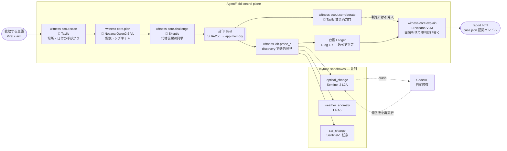
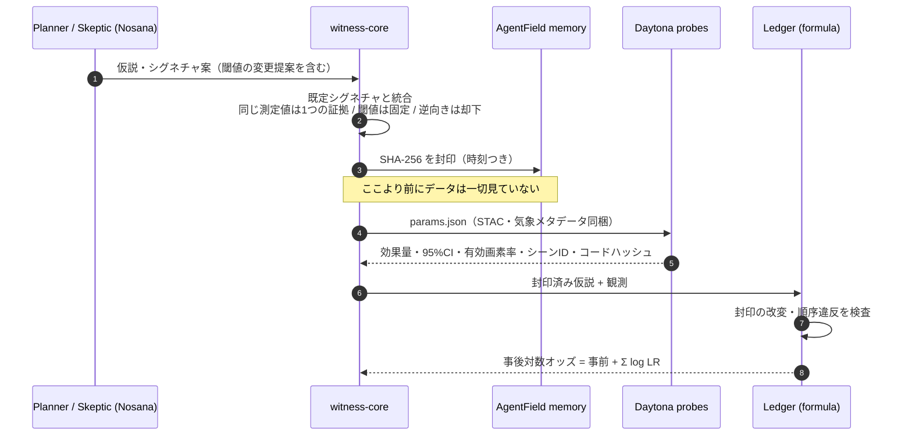
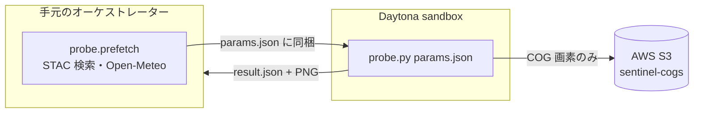

# Architecture / アーキテクチャ

> **AI に結論を出させず、実験を設計させる。**
> Orbital Witness turns a viral claim into a *pre-registered experiment*, measures it with satellites and weather reanalysis, and decides by formula — not by an LLM.

## 1. End-to-end flow / 全体の流れ

| Step | Node / reasoner | Sponsor | Output |
|---|---|---|---|
| 1 | `witness-scout.scan` | **Tavily** (optional) | news hints: place, date, event type |
| 2 | `witness-core.plan` | **Nosana** LLM via **AgentField** `app.ai` | `PlanDraft` → geocoded `Hypothesis` |
| 3 | `witness-core.challenge` | **Nosana** (Skeptic role) | alternative explanations; proposals are *logged, never applied* to thresholds |
| 4 | `prereg.seal` | **AgentField** `app.memory` | SHA-256 of the hypothesis, written **before** any data is fetched |
| 5 | `witness-lab.probe_*` | **AgentField** discovery → **Daytona** | one isolated sandbox per sensor, run in parallel |
| 5′ | `repair` loop | **CodeAF** (via AgentField `app.harness`) | fixes probe code that crashes; constants/thresholds are protected |
| 6 | `ledger.aggregate` | — (pure Python) | `supported` / `contradicted` / `inconclusive` + posterior |
| 7 | `witness-core.explain` | **Nosana** VLM | plain-language explanation of before/after/change images; cannot change the verdict |

## 2. Why the verdict is trustworthy / 判定を信頼できる理由

* **Pre-registration / 事前登録** — `witness/prereg.py`. The hypothesis (place, time windows, signatures, thresholds) is hashed before observation; `ledger.aggregate` refuses results if the hash changed or observations predate the seal.
* **AI cannot move the goalposts / AI は閾値を動かせない** — `witness/planning.py::merge_signatures`. Thresholds are physical defaults in `witness/signatures.py`. LLM proposals that tighten are logged only (LLMs pushed every threshold to the cap in testing), loosening and opposite-direction proposals are rejected, and the same `(probe, measure)` is never counted twice.
* **Difference-in-differences / 差の差** — `witness/probes/optical_change.py`. Change in the event window minus change in the same season one year earlier; 95% CI from spatial block bootstrap (`_stats.py`). For short-lived floods the post-event scenes are taken closest to the event date.
* **Formula, not opinion / 数式で判定** — `witness/ledger.py`. Each signature → confirm (CI lower ≥ threshold), refute (CI upper < threshold) or null; `LR = sens/(1−spec)` or `(1−sens)/spec`; sensors are grouped so correlated evidence is down-weighted (`Σ/√n` per sensor).

## 3. Sandbox data path / サンドボックスのデータ経路

The Daytona tier blocks catalog APIs from sandboxes, so the orchestrator fetches *metadata* (STAC items, ERA5 series) and ships it inside `params.json`; the sandbox only reads *pixels* from S3. Generated or repaired code therefore never needs general internet access. With `WITNESS_RESTRICT_NETWORK=1` (higher tiers) a `domain_allow_list` is applied on top.

## 4. Evidence bundle / 証拠バンドル (`runs/<run_id>/`)

| File | Content |
|---|---|
| `prereg.json` | sealed hypothesis + SHA-256 + sealed_at |
| `probes/<probe>/` | exact probe code that ran (hash recorded), `params.json` |
| `artifacts/<probe>/` | `before.png`, `after.png`, `change_*.png`, `result.json` |
| `case.json` | plan log, results with CIs and scene IDs, ledger entries, explanation, news |
| `report.html` | human-readable report |

## 5. Extending / 拡張

* **New event type** — add signatures to `witness/signatures.py` (probe, measure, direction, minimum effect, physical rationale).
* **New sensor** — add `witness/probes/<name>.py` following the probe contract (`params.json` in, `RESULT_JSON=` out, exit 3 = no data) and register it as a `probe_<name>` reasoner in `nodes/lab.py`; core discovers it at runtime.
* **Fallbacks** — `WITNESS_TAVILY=0` runs without news; `WITNESS_LLM=openrouter` swaps the LLM backend if the Nosana GPU is down; `WITNESS_DIRECT=1` runs without the control plane.
